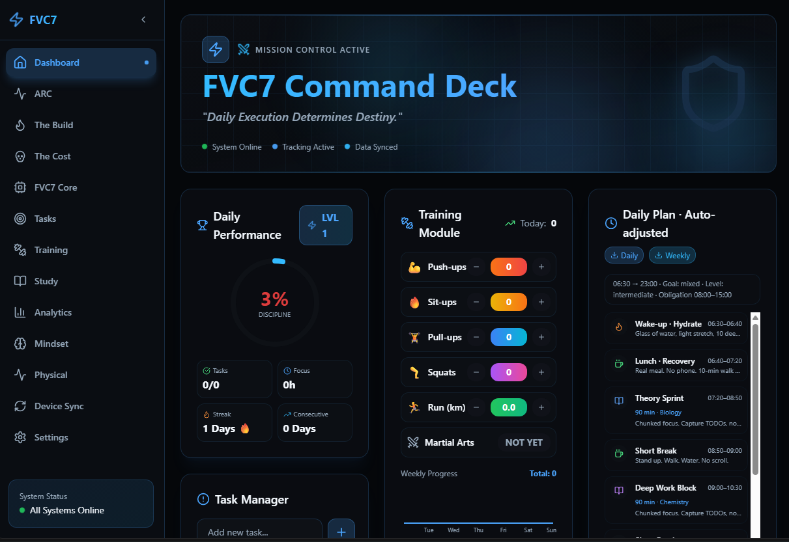

# FVC7 — Local-First Discipline Tracker

> A few months of night shifts, built while broke. It's free. Take it, break it, make it better.
> Someone out there will turn this into something great — that's the whole point of putting it on GitHub.

A fully offline, local-first tracker for a long training + study protocol: phased workout plan,
daily quests, study tracking, analytics, accountability screens, device-to-device sync and a
quantized AI model that runs **inside your browser** (WebGPU, ~350 MB, downloaded once and cached).

- No account, no server, no telemetry. All data lives in `localStorage` on your device.
- Everything personal (name, dates, deadline, exam) is configured on first launch.
- Runs as a web app, an installable PWA, and a Windows desktop app (Electron).



**Watch the demo:** [`public/video.mp4`](public/video.mp4)

## Quick start (web)

```sh
npm install
npm run dev        # http://localhost:8080
npm run build      # production build in dist/
```

On first launch you set your name, start date, deadline and (optionally) an exam date. Change any of
it later in **Settings** inside the dashboard.

## Local AI core

The **FVC7 Core** tab downloads `Qwen2.5-0.5B-Instruct` (~350 MB) automatically the first time you
open it, then runs it locally with WebGPU. Requires Chrome or Edge (desktop, or Android with WebGPU
enabled). After the first download it works with no internet.

## Desktop app (Windows)

One-click build via the batch script:

```sh
npm run dist:exe        # runs build-exe.bat
```

Or manually:

```sh
npm install
npm run build
npm run pack            # packages win32-x64 into electron-release/
```

The output folder `electron-release/FVC7 Leveller-win32-x64/` contains `FVC7 Leveller.exe` — no
installer needed, just run it. The batch script also offers to zip it into `release/` for sharing.

> Electron needs ~1–2 GB free disk space during the build (it downloads and extracts the Electron
> binary). If the build fails with "not enough space on the disk", free up space and retry — the
> binary is cached after the first successful run.

## Data & sync

Use **Device Sync** to export a single JSON file with all your data and import it on another device
(Merge keeps the highest progress values, Replace overwrites).

## Tech

Vite · React · TypeScript · Tailwind CSS · shadcn/ui · Electron · @mlc-ai/web-llm · ExcelJS

## License

MIT — do whatever you want with it.
